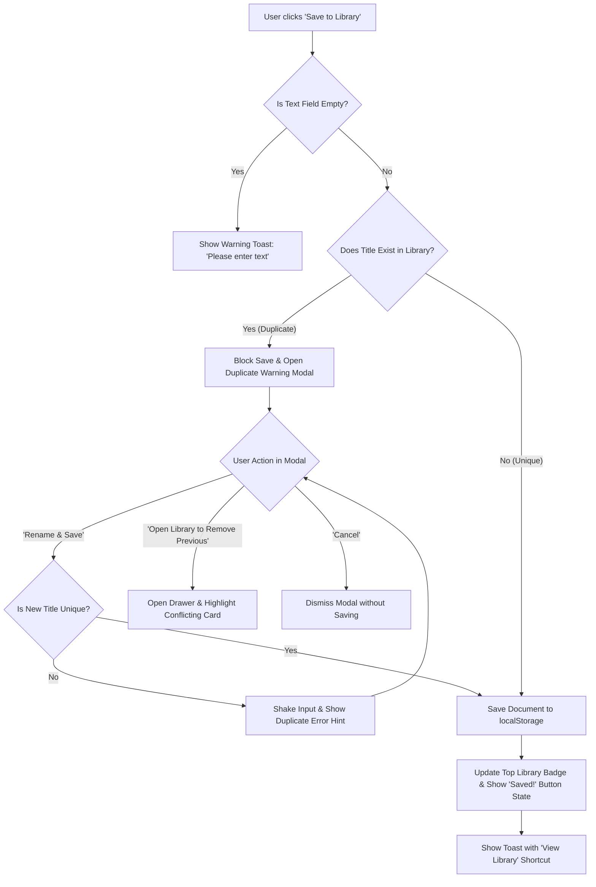
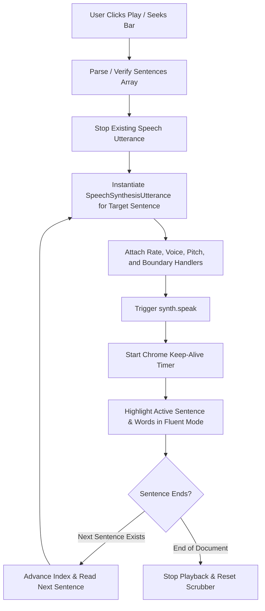

# Product Requirements Document (PRD)
## Read Fluent — Intelligent Text-to-Speech Studio & High-Capacity Document Reader

**Document Version:** 1.0.0  
**Status:** Approved / Active  
**Author:** DeepMind Agentic Engineering & Read Fluent Product Team  
**Date:** October 2026  
**Repository:** `c:\ReadFluent`  
**Application URL:** `http://localhost:8080` (or `index.html`)

---

## 1. Executive Summary & Vision

### 1.1 Product Overview
**Read Fluent** is an intelligent, high-performance client-side document reader and speech synthesis workstation. It is engineered to process massive textual documents (supporting files up to 1GB) across plain text, PDF, and Microsoft Word (`.docx`) formats with zero interface lag, smooth audio seeking, synchronized karaoke-style sentence/word highlighting, real-time speed adjustments, and robust local library persistence.

### 1.2 Core Value Proposition
- **Ultra-High Capacity:** Native chunked streaming that handles files up to 1GB without freezing browser threads or triggering memory crashes.
- **Zero-Lag Interactive Audio:** Instant scrub-seeking across sentences, dynamic speed variation (0.5x to 3.0x) on the fly, and automatic Chrome 15-second speech freeze mitigation.
- **Synchronized Fluent Mode:** Dual-mode workspace offering both raw direct editing and an interactive teleprompter view with real-time active word highlights.
- **Zero-Cloud Privacy:** 100% client-side parsing and local persistence, ensuring sensitive user documents never leave the local environment.
- **Duplicate-Free Library:** Built-in title uniqueness guardrails ensuring no two documents share the same name.

### 1.3 Target Audience
- **Students & Researchers:** Reading academic papers, dissertations, and lengthy textbooks.
- **Professionals & Executives:** Reviewing corporate reports, legal contracts, and documentation hands-free.
- **Auditory Learners & Language Learners:** Improving pronunciation and comprehension via synchronized visual karaoke tracking.
- **Accessibility Seekers:** Visually impaired or dyslexic users requiring customizable speech rate, contrast, and voice profiles.

---

## 2. Technical Architecture & Stack

```
+-----------------------------------------------------------------------------------+
|                                  READ FLUENT UI                                   |
|   [ Top Navigation & Stats ]    [ Dual-View Workspace ]    [ Sleek Audio Dock ]   |
+-----------------------------------------------------------------------------------+
          |                                  |                             |
          v                                  v                             v
+-----------------------+        +-----------------------+     +--------------------+
|  File Processor       |        |  View / Teleprompter  |     |  Speech Engine     |
|  - Chunked FileReader |        |  - Edit & Paste Mode  |     |  - Sentence Queue  |
|  - PDF.js v3.11       |        |  - Karaoke Word Sync  |     |  - Seek Scrubber   |
|  - Mammoth.js v1.6    |        |  - Click-to-Seek      |     |  - Speed (0.5-3x)  |
+-----------------------+        +-----------------------+     +--------------------+
          |                                  |                             |
          +----------------------------------+-----------------------------+
                                             |
                                             v
                             +-------------------------------+
                             |    Library Storage Engine     |
                             |    - localStorage (Primary)   |
                             |    - Duplicate Title Guard    |
                             |    - Direct Card Audio Play   |
                             +-------------------------------+
```

### 2.1 Technology Components
- **Markup & Structure:** Semantic HTML5 (`index.html`) with ARIA accessibility roles and responsive layouts.
- **Styling & Tokens:** Vanilla CSS3 (`style.css`) with CSS custom properties, glassmorphism (`backdrop-filter`), responsive grid/flexbox layouts, and Dark/Light theme switching.
- **Logic & Control:** Vanilla JavaScript (ES6+, `app.js`) structured into modular controllers (`LibraryStore`, `SpeechEngine`, `FileProcessor`, `ReadFluentApp`).
- **External Client Libraries (via CDN):**
  - **Mozilla PDF.js (v3.11.174):** Client-side PDF page rendering and text extraction.
  - **Mammoth.js (v1.6.0):** Client-side `.docx` binary parsing and raw textual extraction.
  - **Google Fonts:** Outfit (Brand/Headings), Plus Jakarta Sans (Body), JetBrains Mono (Stats/Code).

---

## 3. Detailed Feature Specifications

### 3.1 Logo & Branding Header
- **Specification:**
  - Displays the brand logo **"Read Fluent"** with an SVG icon combining an open book, audio ripple wave, and multi-tone violet/pink gradient.
  - Tagline: *"Intelligent Speech & Document Studio"*.
  - Live document analytics badge displaying:
    - **Word Count:** Total words calculated dynamically on input (`\S+`).
    - **Estimated Listening Time:** Computed dynamically via `Words / (150 WPM * Speed)`.
    - **Character Count:** Exact string character length.
  - Quick action header buttons: Upload File, Download, Saved Library Toggle (with live count badge), and Light/Dark Theme Switcher.

### 3.2 High-Capacity Text Field (Up to 1GB Support)
- **Specification:**
  - Full-featured, distraction-free `<textarea>` supporting direct typing, clipboard pasting, and auto-populated file contents.
  - Quick toolbar utilities: **Paste**, **Copy**, **Clear**, **Save to Library**, and **Sample Text**.
  - **Memory Safety & 1GB Handling:**
    - Files are read in **2MB chunks** using `Blob.slice()` and asynchronous `FileReader` execution loop.
    - Yields execution between chunks via `setTimeout(0)` to prevent UI thread freezing.
    - Shows an animated progress bar modal with percentage and processed megabytes (`X MB / Y MB`).
    - Files exceeding 100MB trigger a non-blocking memory advisory alert advising the user of high browser heap usage.

### 3.3 Universal Document Upload Engine
- **Specification:**
  - Supports `.txt`, `.pdf`, `.docx`, `.doc`, `.md`, `.rtf`, `.log`, `.csv`, `.json`.
  - Accessible via both the **Upload File** button and direct **Drag & Drop** onto the workspace with a glowing visual drop zone overlay.
  - Automatic title extraction from uploaded filenames (sanitized without extension).

### 3.4 Local File Download
- **Specification:**
  - Single-click **Download** button that exports the text field content to the user's local device as a UTF-8 `.txt` file.
  - File naming convention: `<Document_Title>.txt` (sanitizing special characters).

### 3.5 Sleek Seek Scrubber (Forward / Backward Seeking)
- **Specification:**
  - Custom `<input type="range">` scrubber with gradient fill bar and glowing thumb handle.
  - Divided by sentence boundaries using regex-based sentence tokenization.
  - **Zero-Lag Seeking:** Dragging or clicking the scrubber updates the current sentence index immediately, cancels existing speech utterances without stuttering, and seamlessly resumes speech from the new offset.
  - Includes hover tooltip displaying the seek percentage and target timestamp.
  - Displays live time tracking: Current Elapsed Time (`M:SS`) and Total Duration (`M:SS`).

### 3.6 Sleek Speed Controller (0.5x to 3.0x)
- **Specification:**
  - Smooth range slider spanning **0.5x to 3.0x** with `0.1x` increments.
  - Real-time rate badge display (e.g., `1.2x`).
  - Five quick-access preset chips: **0.8x**, **1.0x**, **1.2x**, **1.5x**, **2.0x**.
  - **Seamless Rate Switching:** Changing speed during active playback recalculates remaining duration and updates sentence speech rate on the fly with zero audio interruption.

### 3.7 Master Playback Engine & Skip Controls
- **Specification:**
  - **Play / Pause Master Button:** Circular glowing button with pulse-ring animation during active speech. Toggles between playing and paused states.
  - **Stop Button:** Immediately halts speech synthesis and resets reading position to the beginning.
  - **Backward 15s (`-15s`):** Calculates words per second (`150 WPM * Speed / 60`), rewinds approximately ~38 words across sentences, and continues reading.
  - **Forward 15s (`+15s`):** Advances ~15 seconds worth of words forward.
  - **Chrome 15-Second Cutoff Workaround:** Automatically runs a keep-alive background interval (`setInterval` calling `synth.pause()` and `synth.resume()`) to prevent Chromium browsers from silencing long utterances after 15 seconds.

### 3.8 Synchronized Fluent Reader Mode (Karaoke / Teleprompter)
- **Specification:**
  - Accessible via the **"Fluent Reader Mode"** tab in the toolbar.
  - Transforms raw text into clean, typography-optimized interactive paragraphs.
  - **Active Sentence Highlighting:** The currently spoken sentence receives a soft violet glow aura, enlarged typography, and left accent border.
  - **Word-Level Highlighting:** The exact active word being spoken is highlighted in luminous indigo using `SpeechSynthesisUtterance.onboundary` word events.
  - **Auto-Scrolling:** Automatically scrolls the container to keep the active sentence vertically centered.
  - **Click-to-Seek:** Clicking any sentence in Fluent Mode immediately seeks and begins reading from that sentence.

### 3.9 Local Storage Library & In-Library Playback
- **Specification:**
  - Persists documents in browser `localStorage` under the key `readfluent_library_items_v1`.
  - Slide-out library drawer featuring:
    - Real-time search filter matching title or content substrings.
    - Document metadata: Created/Updated timestamp, total word count, and reading completion percentage bar.
    - Saved audio badge: Associated speech voice and playback speed.
    - **"▶ Play Audio" / "⏸ Pause" button directly on each card:** Plays audio directly from the library card with an active 3-bar animated soundwave equalizer.
    - **"Open in Reader":** Restores document content, seek index, voice, and speed into the main workspace.
    - **"Download":** Exports saved text directly.
    - **"Delete":** Removes item with user confirmation.
    - **"Clear All":** Clears entire library with confirmation modal.

### 3.10 Duplicate File Name Prevention & Resolution System
- **Specification:**
  - **Rule:** **No two documents in the library may share the same title** (comparison is case-insensitive and whitespace-trimmed).
  - **Save Protection:**
    - If a user attempts to save a document whose title already belongs to another document in the library, **the file is NOT saved**.
    - The **Duplicate Name Warning Modal** automatically appears:
      - Informs the user of the conflicting title.
      - Pre-fills an auto-incremented suggestion (e.g., `Document Name (2)`).
      - **"Rename & Save":** Verifies uniqueness and saves under the new name.
      - **"Open Library to Remove Previous File":** Opens the library drawer and highlights the conflicting file card with an amber pulsing glow so the user can delete it before saving.
      - **"Cancel":** Aborts the save operation.
  - **Inline Rename Protection:**
    - When renaming an existing library card, entering a name that duplicates another file is rejected with an error toast, an input shake animation, and remains unsaved.
  - **Toolbar Title Rename Protection:**
    - Clicking `#currentDocTitle` enforces the same uniqueness check.

### 3.11 Inline Title Renaming
- **Specification:**
  - Every card in the library features an **Edit Pencil icon (`✏️`)** next to the title.
  - Clicking the title text or pencil icon toggles an inline input with **`✓` (Save)** and **`✕` (Cancel)** buttons.
  - Supports **Enter** key to commit changes and **Escape** to cancel.
  - Updating the title automatically synchronizes with `localStorage` and updates the reader toolbar if the file is currently loaded.

---

## 4. Data Models & Schemas

### 4.1 Document Record (`DocumentRecord`)
```typescript
interface DocumentRecord {
  id: string;                    // Unique identifier (e.g., "doc_1729881000000_a8f9z")
  title: string;                 // Unique document title (case-insensitive uniqueness)
  content: string;               // Full text body of the document
  wordCount: number;             // Total word count (\S+)
  charCount: number;             // Total character count
  progressPercent: number;       // Playback progress (0 - 100%)
  activeSentenceIndex: number;   // Bookmark for last spoken sentence index
  speed: number;                 // Playback speed (0.5 - 3.0)
  voiceName: string;             // Voice identifier URI / name
  createdAt: number;             // Unix timestamp of initial creation
  updatedAt: number;             // Unix timestamp of last modification
}
```

### 4.2 Application State (`AppState`)
```typescript
interface AppState {
  currentDocId: string | null;   // Active document ID or null if unsaved
  currentTitle: string;          // Current active document title
  currentSpeed: number;          // Active playback rate (default 1.0)
  activeSentenceIndex: number;   // Active sentence position
  isPlaying: boolean;            // Global speech playback status
  isPaused: boolean;             // Paused playback status
  theme: 'dark' | 'light';       // Active UI theme
}
```

---

## 5. UI/UX Design System & Theme Specifications

| Token | Dark Mode (Default) | Light Mode (Paper) | Purpose |
| :--- | :--- | :--- | :--- |
| `--bg-primary` | `#0a0d14` (Obsidian) | `#f8fafc` (Paper White) | Application base background |
| `--bg-surface` | `rgba(18, 24, 38, 0.75)` | `rgba(255, 255, 255, 0.85)` | Glassmorphic workspace card |
| `--bg-secondary` | `#111726` | `#f1f5f9` | Control docks & toolbar buttons |
| `--accent-gradient` | `linear-gradient(135deg, #6366f1, #8b5cf6, #ec4899)` | `linear-gradient(135deg, #6366f1, #8b5cf6, #ec4899)` | Primary buttons, logo, scrubber fill |
| `--accent-emerald` | `#10b981` | `#059669` | Success notifications, save confirmation |
| `--accent-rose` | `#f43f5e` | `#e11d48` | Delete actions, errors, duplicate alerts |
| `--accent-amber` | `#f59e0b` | `#d97706` | Large file warnings, duplicate highlights |

---

## 6. Non-Functional Requirements (NFRs)

### 6.1 Performance & Latency
- **Seek Responsiveness:** Scrubbing seeking latency must remain under **50ms** without UI thread interruption or audio stuttering.
- **Speed Rate Update:** Dynamic speech speed adjustments must apply within **100ms** without re-tokenizing sentences.
- **Large File Streaming:** 100MB+ plain text files must ingest in < 2.5 seconds using non-blocking 2MB chunk slices.

### 6.2 Reliability & Browser Quirks
- **Chrome 15s Speech Synthesis Bug:** Must be proactively mitigated using periodic pause/resume keep-alive timers.
- **Protocol Portability:** Must run with 100% functionality on both local HTTP servers (`http://localhost:8080`) and local disk protocol (`file:///`).

### 6.3 Security & Privacy
- **Zero Remote Transmission:** All document text, speech rendering, and local library files remain strictly on the user's local device.
- **XSS Sanitization:** All dynamic user titles and snippets rendered into the DOM pass through HTML entity escaping (`escapeHtml`).

---

## 7. User Flows & State Diagrams

### 7.1 Save & Duplicate Resolution Flow


### 7.2 Speech Playback & Seeking Flow


---

## 8. Supabase Cloud Backend & Admin Management Architecture

### 8.1 Supabase Integration
- **Authentication**: Native Supabase Auth supporting Sign Up (with full name metadata), Sign In with email/password, Password Recovery via email redirect (`#access_token=...&type=recovery`), and Sign Out.
- **User-Isolated Document Storage**: PostgreSQL table `public.documents` with Row Level Security (RLS) policies enforcing that users can only select, insert, update, and delete their own documents (`auth.uid() = user_id`).
- **User Storage Buckets**: Supabase Storage bucket `user_documents` organizing file uploads into isolated folders by user ID (`${auth.uid()}/*`).
- **Per-User Title Uniqueness**: Unique index `idx_documents_user_title_unique ON public.documents (user_id, lower(trim(title)))`.
- **Admin Management Console**:
  - Secure Postgres `SECURITY DEFINER` RPC functions: `admin_list_users()`, `admin_create_user()`, `admin_delete_user()`, `admin_update_user_role()`, and `admin_get_user_documents()`.
  - Admin UI providing user directory inspection, statistics ribbon (total users, total documents, total admins), new user creation form, role switching, user documents viewer, and account deletion with cascade.

---

## 9. Future Roadmap & Enhancements

- **Phase 3 — High-Fidelity Neural TTS:** Integration with cloud Neural TTS providers (OpenAI TTS, ElevenLabs, Amazon Polly) alongside native browser voices.
- **Phase 4 — Audio File Export:** Ability to record and download synthesized speech as `.mp3` or `.wav` audio files.
- **Phase 5 — OCR Image Ingestion:** Optical Character Recognition (via Tesseract.js) to extract text directly from scanned documents and images.

---

## 10. Verification & Sign-Off Checklist

- [x] Responsive layout with top logo, stats counter, workspace, and floating player dock.
- [x] Text input field supporting up to 1GB files with memory streaming and safety alerts.
- [x] Upload button supporting TXT, PDF, Word DOCX with progress indicators.
- [x] Local device Download button exporting content as `.txt`.
- [x] Sleek scrubber slider for forward/backward seeking without audio lag.
- [x] Sleek speed slider (0.5x - 3.0x) with instant rate updates and preset chips.
- [x] Play, Stop, +15s, -15s, and Save to Library master controls.
- [x] Synchronized Fluent Reader Karaoke teleprompter with clickable sentence seeking.
- [x] LocalStorage & Supabase cloud library preserving text, reading progress, voice, and speed.
- [x] Supabase user authentication (Sign In, Sign Up, Forgot Password, Reset Password, Sign Out).
- [x] User-wise document and original file isolation with Supabase RLS and Storage.
- [x] Dedicated Admin Management Console for user creation, deletion, role modification, and inspection.
- [x] GitHub Pages hosting deployment configuration via GitHub Actions CI/CD (`.github/workflows/deploy.yml`).
- [x] Direct audio playback and animated soundwave equalizer on library cards.
- [x] Strict duplicate file name prevention with conflict resolution modal.
- [x] Inline title renaming on library cards with keyboard shortcuts.
- [x] Dark Mode and Light Mode theme toggle with persistent user preference.
